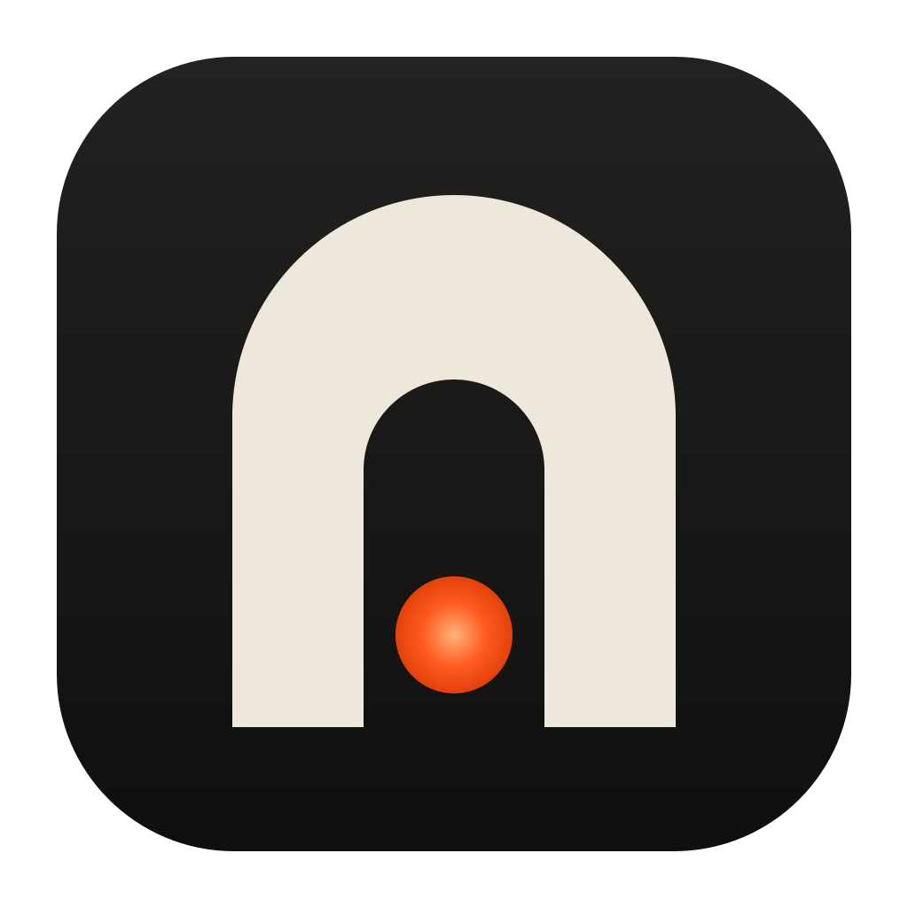

<p align="center">
  
</p>

<h1 align="center">Kiln</h1>

<p align="center">
  <strong>A design canvas made of real HTML and CSS.</strong><br/>
  Draw with real flexbox, fonts and effects, export the exact same code, and let Claude Code, Codex or Gemini design on the canvas with you. Free and open source.
</p>

<p align="center">
  <a href="https://github.com/splashxmoon/kiln/stargazers"></a>
  
  
</p>

<p align="center">
  <a href="https://github.com/splashxmoon/kiln/releases/latest/download/Kiln-universal.dmg"><b>Download for Mac</b></a> (Apple silicon and Intel, signed and notarized)
  <br/>or run it in the browser: <code>npm install && npm run dev</code>
</p>

<!-- TODO before launch: docs/assets/hero.png, the canvas beside its exported code, 1920x1080 -->

Most design tools end in a handoff: someone redraws the screen in code. In Kiln the canvas already is the code, so there is nothing to translate.

- **Real layers.** Every layer is a DOM element. Frames are real flexbox, text is real fonts, effects are real CSS.
- **Real export.** Copy any frame as HTML and CSS, React with CSS Modules, React with Tailwind v4, or Vue. What you see is what you ship.
- **Agents on your plan.** Claude Code, Codex, Gemini CLI, Cursor Agent and OpenCode connect over MCP and edit the canvas like you do, billed to the subscription you already have. API keys work too.
- **Paste HTML, get layers.** Paste markup from anywhere, or let an agent write it, and it turns into editable layers.
- **Live shaders.** Seven original GPU shader layers you can tune and export as standalone code.
- **Tokens and comments.** Colour tokens, a consistency check that snaps near-matches to them, and comments on the canvas.

## Get started

1. **Download Kiln** for Mac above, or run the web app from source.
2. **Make a file.** Start blank or from the shop template.
3. **Connect an agent** (optional). Open the agent panel with `⌘J` and pick a coding tool you're signed in to, or connect one yourself:

```bash
claude mcp add --transport http kiln http://127.0.0.1:7457/mcp
```

4. **Export.** Select a frame and copy its code.

## Build from source

```bash
npm install
npm run dev            # web app → http://localhost:5173  (#/ landing, #/files, #/new)
npm run desktop:dev    # desktop app (needs Rust: https://rustup.rs)
npm run desktop:build  # .app / .dmg / .msi / .AppImage
```

## Bring your own agent

Kiln never resells model access. Every agent call is billed to the account the user already has.

| Provider | How it runs | Where |
|---|---|---|
| Claude Code, Codex, Gemini CLI, Cursor Agent, OpenCode | Kiln launches the vendor's official CLI (headless) under the user's own login and points it at Kiln's local MCP server | Desktop |
| Anthropic API, OpenAI API, OpenRouter, Ollama, any OpenAI-compatible endpoint | Direct calls with the user's key (stored only on the device) | Desktop + web |
| Any MCP client (Claude Code, Codex, Cursor, VS Code, Zed, Windsurf…) | Connects to `http://127.0.0.1:7457/mcp`; one-click **Connect** writes the CLI's own config | Desktop |
| Browser agents / scripts | `window.kiln.call(tool, args)` — run `kiln.help()` | Web |

```bash
claude mcp add --transport http kiln http://127.0.0.1:7457/mcp
codex mcp add kiln --url http://127.0.0.1:7457/mcp
```

Agent tools: `get_document`, `get_tree`, `get_node`, `get_selection`, `get_screenshot`, `create_node`, `write_html` (HTML → native editable layers), `update_nodes`, `set_text`, `delete_nodes`, `duplicate_node`, `move_node`, `select_nodes`, `export_code`, `create_token`, `apply_token`, `add_comment`, `create_page`, `find_nodes`.

Offline quick actions (no account): mobile variant, tidy spacing (4px grid), consistency check (bind near-match colours to tokens, flag off-scale type), replace placeholder copy, name layers.

## Architecture

```
src/
  editor/        document model, store (immer + undo), canvas, overlays, panels
    types.ts       KDoc / KNode — flat node map, parentId + children
    style.ts       node → CSS. The single source of truth for canvas AND export
    Canvas.tsx     gestures: select, move+snap, flex reorder, reparent, resize, draw, pan/zoom
    importHtml.ts  HTML → layers via computed styles (paste HTML, agent write_html)
    snapshot.ts    layer → PNG (foreignObject, with a DOM box-painter fallback for WebKit)
  codegen/       HTML+CSS, React+CSS Modules, React+Tailwind v4, Vue SFC, tokens
  shaders/       7 original WebGL shaders, one shared GL context, standalone export
  agent/         tool API, providers (CLI subscriptions + API keys), quick actions
  platform/      storage (IndexedDB / .kiln files), Tauri bridges
  site/          marketing landing page
src-tauri/       Rust: file storage, export, MCP server (axum), agent CLI runner
```

Documents are plain JSON (`.kiln` in `~/Documents/Kiln` on desktop, IndexedDB in the browser).

## Keyboard

`V` move · `H` hand · `F` frame · `R` rect · `O` ellipse · `T` text · `I` image · `S` shader · `C` comment · `⇧A` flex · `⌘G` wrap in stack · `⇧⌘G` unwrap · `⌘D` duplicate · `⌘K` command palette · `⌘J` agent · `⇧1` fit · `?` all shortcuts

## Contributing

Bug reports, ideas and pull requests are welcome. See [CONTRIBUTING.md](CONTRIBUTING.md). Security issues go to [SECURITY.md](SECURITY.md), not public issues.

## License

MIT. See [LICENSE](LICENSE). Coding-tool marks adapted from [LobeHub Icons](https://github.com/lobehub/lobe-icons) (MIT).
