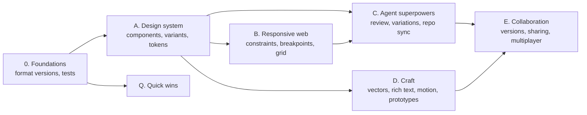

# Kiln roadmap

Kiln has two advantages no other design tool has together, and this plan leans on both:

1. **Layers are real HTML/CSS.** What you draw is what ships, so features should make the output production-grade (components with props, responsive CSS, real motion).
2. **Agents run on the user's own subscriptions** (Claude Code, Codex, Cursor, Gemini, OpenCode, or an API key). Features should give agents more to work with and make their work safe to accept.

Sizes are rough: **S** is a day or less, **M** a few days, **L** a week or more. What exists today is listed at the end so nothing here repeats it.

## Recommended order

| Phase | Theme | Why now | Size |
|---|---|---|---|
| 0 | Foundations | Components change the file format; that needs migrations and tests first | M |
| Q | Quick wins | Small, visible, and they run alongside everything else | M total |
| A | Design system | The biggest gap: no components, instances or variants | L |
| B | Responsive web | Kiln's output is web pages, so they must resize properly | L |
| C | Agent superpowers | What makes Kiln different; most of it builds on A and B | L |
| D | Craft | The deeper editing tools designers expect | L |
| E | Collaboration | Versions first, then sharing, then live multiplayer | L |

## 0. Foundations (do first, small)

| Item | Why | Size |
|---|---|---|
| **File format version + migrations** (`KDoc.version`, a `migrate()` step on open, tests per step) | Components, variants and constraints all change the document. Old files must keep opening | S |
| **A JS test runner (Vitest)** for codegen, tokens, geometry, `shortcut()`, model listing | There is none today; codegen regressions are invisible until someone exports | S |
| **Undo groups per agent turn** | One "undo" reverts a whole agent turn, and is the base for "Revert this turn" in C | S |
| **Large-document performance**: virtualised layers list, culling off-screen nodes on the canvas | Needed before component libraries make files much bigger | M |

## Q. Quick wins (run in parallel with everything)

| Feature | Size |
|---|---|
| Distribute and tidy up: even spacing for a selection, in rows or a grid | S |
| Alt-hover measuring: distances between the selection and the hovered layer | S |
| Select matching (same fill, font, type, token) | S |
| Batch rename with numbering; find and replace across text layers | S |
| Recently used and document colours in the picker | S |
| Copy and paste between files keeps tokens (bug) | S |
| Copy as CSS / copy as Tailwind for one layer (context menu) | S |
| Export SVG, JPG, PDF; export presets per layer (scale, format, suffix); export many artboards at once | M |
| Rulers and guides you drag out | M |
| Minimap for big pages | M |

## A. Design system

| Feature | What it means | Size |
|---|---|---|
| **Components and instances** | "Make component" turns a layer into a main component. Instances follow it, and changes to the main flow into every instance. Overrides for text, fills, visibility and swapped images are kept per instance; "Reset overrides", "Go to main", "Detach" | L |
| **Variants and properties** | Component properties: variant (state, size), boolean (show icon), text, and instance swap. A property panel on each instance | L |
| **Codegen for components** | Each component exports as a React/Vue component whose properties become props (with types); instances export as `<Button size="sm">` | M |
| **Tokens beyond colour** | Type (text styles), spacing, radius, shadow and opacity tokens, with modes (light/dark). Exported as CSS variables and the Tailwind theme | M |
| **Project library** | Components, tokens and images shared by every file in a project; a Library tab in the left panel; "Update from library" when the library changes | L |
| **Assets panel search** | Search across components, tokens and images, with drag to canvas | S |

## B. Responsive web

| Feature | What it means | Size |
|---|---|---|
| **Min / max width and height** | Matches CSS; stops "fill" layouts from stretching forever | S |
| **Constraints** for absolutely positioned children (left/right/both/centre/scale) | Layers stay pinned when a frame resizes | M |
| **CSS grid layout** | Columns, rows, gaps, spans, and auto-fit grids for card lists; plus layout grids drawn on frames | M |
| **Breakpoints** | One artboard, several widths (desktop, tablet, mobile); per-breakpoint overrides for layout, size, visibility and text size; codegen writes media queries | L |
| **Position sticky / fixed, overflow scroll** | Headers that stick, carousels that scroll, both in Preview and in code | M |
| **Preview at device sizes** | A width switcher and rotate in Preview; drag to resize the page | S |

## C. Agent superpowers

| Feature | What it means | Size |
|---|---|---|
| **Design review (lint)** | A Review panel: contrast below WCAG AA, tap targets under 44px, colours and spacing not on a token, unnamed layers, text overflowing its box, missing alt text. One-click fixes; agents can run it as a tool and fix what it finds | M |
| **Variations side by side** | "Try 3 directions": the agent duplicates the artboard and explores each one beside the original; you keep one and the rest are discarded | M |
| **Review an agent turn before keeping it** | After a turn, a summary of what changed (layers added, edited, deleted) with Keep / Revert this turn | M |
| **Project brief for agents** | Per project: brand voice, audience, palette and type rules, do's and don'ts. Sent with every agent message so results stay on brand | S |
| **Import from a URL** | The desktop app loads a page, captures it as layers (Kiln already imports pasted HTML), and keeps fonts and images | M |
| **Make responsive / make mobile** | Agent actions built on B: generate the tablet and mobile breakpoints for an artboard | S (after B) |
| **Repo sync** | Link a project to a code folder: components and tokens export into it as files, kept up to date; the agent can work on the design and the code in one turn | L |
| **More agent tools** | Components and variants, tokens (list, update, delete), pages (rename, reorder), comments (read, reply, resolve), export an image or SVG, run the design review | M |
| **Image generation and editing** (API providers that support it) | Fill an image layer from a prompt; remove a background | M |
| **Agent on a comment** | Mention the agent in a comment ("make this tighter") and it works on that spot | S |

## D. Craft

| Feature | What it means | Size |
|---|---|---|
| **Vector editing** | Edit points after drawing, bend handles, add and delete points; boolean union, subtract, intersect and exclude; outline stroke | L |
| **Masks** | Clip any layer group by a shape | M |
| **Rich text** | Mixed styles inside one text layer (bold a word, link a phrase), lists, paragraph spacing, text truncation with lines | M |
| **Your own fonts** | Upload fonts into the project; codegen writes `@font-face` | S |
| **Image crop and adjustments** | Crop, fit and fill modes, exposure, contrast, saturation (CSS filters, so they export) | M |
| **Motion** | Hover and pressed states and transitions on layers, plus simple keyframe animations, all exported as CSS | L |
| **Prototyping** | Links between artboards, overlays, scroll-to, smart-animate between states; Preview plays them | L |

## E. Collaboration

| Feature | What it means | Size |
|---|---|---|
| **Version history** | Named versions plus timed autosaves, with a side-by-side preview before restoring | M |
| **Share and publish** | A read-only share link, and publishing an artboard as a real hosted page | L |
| **Comments with mentions and resolve** | Threads, @mentions and a resolved filter | M |
| **Multiplayer** | Live cursors and editing together (CRDT, for example Yjs). The agent's cursor already shows how people would look | L |
| **Figma import** | Frames, auto layout, text and fills from a Figma file | L |
| **Plugins** | Since Kiln already serves its tools over MCP, a plugin can be an MCP server the user adds | M |

## Suggested first sprint

| # | Piece | Phase | Size |
|---|---|---|---|
| 1 | File format version + migrations, Vitest with first codegen tests | 0 | S |
| 2 | Undo groups per agent turn + "Revert this turn" | 0 / C | M |
| 3 | Distribute, select matching, batch rename, Alt-measure | Q | M |
| 4 | Export SVG / JPG / PDF and many artboards | Q | M |
| 5 | Design review panel (contrast, tap targets, off-token values), also as an agent tool | C | M |
| 6 | Components and instances: data model, overrides, layers panel | A | L |

Pieces 1 to 5 can run in parallel. Piece 6 starts once 1 lands.

## What exists today
- **Layers and styles:** frames with flex layout and wrap; rect, ellipse, path (pen), text, image; 7 shader kinds; multiple fills; shadows; blurs; blend modes; per-corner radius.
- **Tokens:** colour tokens, exported as CSS variables and a Tailwind theme.
- **Canvas:** snapping and guides; pixel grid; layout guides; marquee and deep select; alt-drag duplicate; editing several layers with mixed values; align bar; zoom options; comments.
- **Undo:** 200 steps.
- **Code export:** HTML, React, Tailwind, Vue.
- **Image export:** PNG @2x.
- **Preview:** the artboard as a real web page.
- **AI agent:** 5 CLI agents and 5 API options with live model lists, chat history, image attachments, 19 tools also served over MCP, the agent's cursor, outlines and status island on the canvas.
- **Files:** projects (folders) with drag-to-move, Drafts, Trash with restore, pages, layer search, command palette, shortcuts, templates, rename and duplicate.
- **Platforms:** web and macOS desktop; Windows and Linux builds are being prepared.
